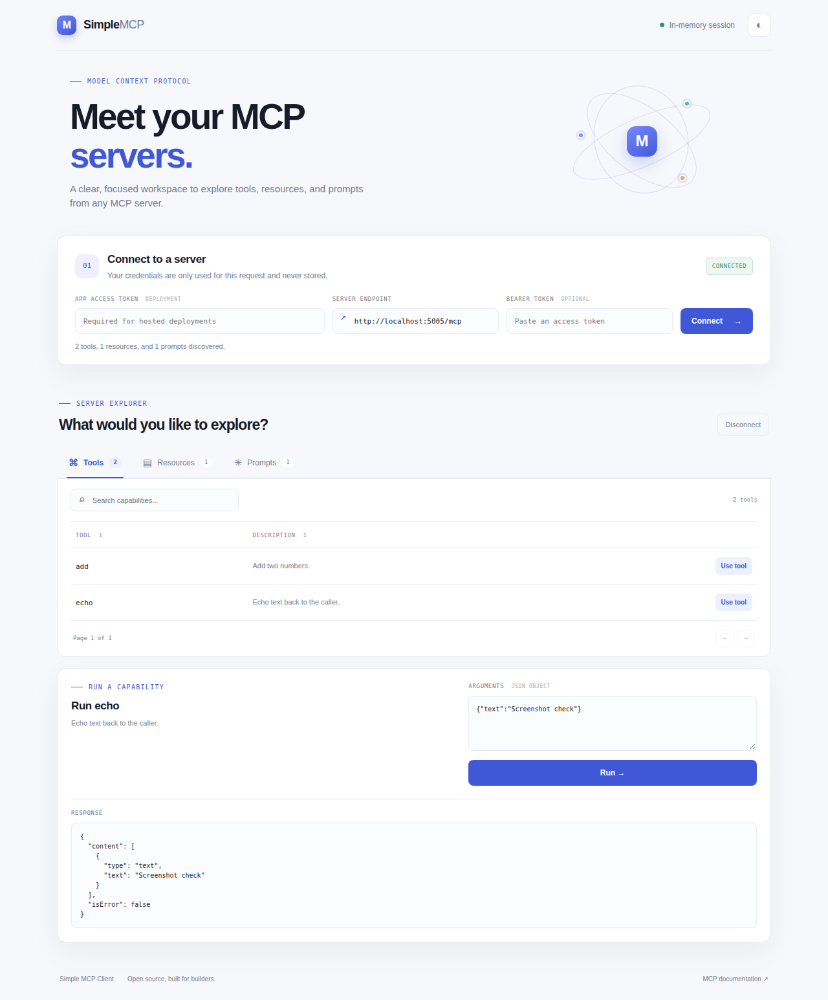

# Simple MCP Client

Simple MCP Client is a lightweight .NET 10 application for exploring and exercising Model Context Protocol servers. It includes a single-process web app, a command-line client, and an in-memory sample server and smoke-test runner. No application data or credentials are written to a database.



## Features

- Connect to MCP servers over Streamable HTTP or stdio.
- Discover and browse tools, resources, and prompts.
- Call tools, read resources, and render prompts with JSON arguments.
- Search, sort, and paginate capability lists in the web UI.
- Send an optional bearer token; credentials are held only in the current page/session and are never persisted.
- Protect hosted API requests with a deployment access token; the token is never persisted.
- Light/dark theme follows the operating-system preference and remembers the theme choice.
- Run locally, in a container, or on Azure Container Apps (ACA).
- Azure infrastructure is defined in Bicep; all workload state remains in memory.

The web UI and its request handlers run together in one ASP.NET Core process; there is no separate API service. In production, the web proxy accepts only HTTPS MCP endpoints whose exact host names appear in `MCP_ALLOWED_HOSTS`. Local development allows HTTP and loopback MCP servers. CLI stdio commands execute locally under the current user.

## Run locally

Prerequisite: [.NET 10 SDK](https://dotnet.microsoft.com/download/dotnet/10.0).

```bash
dotnet restore SimpleMcpClient.slnx
dotnet build SimpleMcpClient.slnx
```

In one terminal, start the in-memory sample MCP server:

```bash
dotnet run --project samples/SimpleMcpClient.SampleServer
```

In another terminal, start the web app:

```bash
ASPNETCORE_ENVIRONMENT=Development dotnet run --project src/SimpleMcpClient.Web
```

Open [http://localhost:8080](http://localhost:8080). The sample server endpoint is `http://localhost:5005/mcp`.

The web app uses the public NuGet feed in this repository because CI and deployment run on GitHub-hosted runners, not Microsoft-managed devices. On a company-managed device, configure the Microsoft-protected NuGet feed described in the [package-feed standard](https://github.com/frkim/ai-coding-standards/blob/main/standards/development/package-feeds.md).

## CLI

Run commands from the repository root:

```bash
# List tools, resources, and prompts
dotnet run --project src/SimpleMcpClient.Cli -- tools http://localhost:5005/mcp
dotnet run --project src/SimpleMcpClient.Cli -- resources http://localhost:5005/mcp
dotnet run --project src/SimpleMcpClient.Cli -- prompts http://localhost:5005/mcp

# Call a tool with JSON arguments
dotnet run --project src/SimpleMcpClient.Cli -- call http://localhost:5005/mcp echo '{"text":"hello MCP"}'

# Read a resource or render a prompt
dotnet run --project src/SimpleMcpClient.Cli -- read http://localhost:5005/mcp memory://welcome
dotnet run --project src/SimpleMcpClient.Cli -- prompt http://localhost:5005/mcp greeting '{"name":"Ada"}'

# Connect to a local stdio server (the separator divides server args from client args)
dotnet run --project src/SimpleMcpClient.Cli -- \
  --stdio dotnet samples/SimpleMcpClient.SampleServer/bin/Debug/net10.0/SimpleMcpClient.SampleServer.dll --stdio -- tools
```

Set `MCP_AUTH_TOKEN` in the CLI environment to send an `Authorization: Bearer` header to an HTTP server. Do not put tokens in command-line arguments, shell history, or source control.

## Build, lint, and test

```bash
dotnet format SimpleMcpClient.slnx --verify-no-changes --no-restore
dotnet build SimpleMcpClient.slnx --configuration Release -warnaserror
dotnet run --project tests/SimpleMcpClient.SmokeTests --configuration Release
```

The smoke-test application starts the in-memory sample server and verifies HTTP and stdio initialization, tool discovery and invocation, resource listing and reading, prompt listing and rendering, and endpoint validation.

## Container

```bash
docker build -t simplemcpclient .
: "${WEB_AUTH_TOKEN:?Set a strong random token}"
docker run --rm -p 8080:8080 \
  -e MCP_ALLOWED_HOSTS=mcp.example.com \
  -e WEB_AUTH_TOKEN="$WEB_AUTH_TOKEN" \
  simplemcpclient
```

The container runs as the non-root .NET `app` user. Set `MCP_ALLOWED_HOSTS` to a comma-separated list of exact MCP host names; omit schemes and paths. The production web proxy rejects all destinations that are not in this allowlist.

## Deploy to Azure Container Apps

The `deploy` workflow provisions a Consumption ACA environment, a Basic Azure Container Registry, a user-assigned managed identity, Log Analytics, and Application Insights. The identity is granted `AcrPull`; the app scales from zero to two replicas and exposes liveness/readiness probes. The CI workflow lints and compiles Bicep on every pull request. Deployments run from `main` or by manual dispatch and use the `production` GitHub environment.

Configure these GitHub Actions settings:

| Setting | Type | Purpose |
| --- | --- | --- |
| `AZURE_CREDENTIALS` | Secret | Azure service-principal JSON containing `clientId`, `clientSecret`, `subscriptionId`, and `tenantId` |
| `WEB_AUTH_TOKEN` | Secret | Strong random token required to access the hosted web API |
| `AZURE_RESOURCE_GROUP` | Variable | Resource group for the app, for example `rg-simplemcpclient-prod-eastus` |
| `AZURE_LOCATION` | Variable | Azure region, for example `eastus` |
| `AZURE_OWNER` | Variable | Workload owner tag |
| `AZURE_COST_CENTER` | Variable | Cost-center tag |
| `MCP_ALLOWED_HOSTS` | Variable | Comma-separated MCP host allowlist; configure before enabling user connections |

Enter the `WEB_AUTH_TOKEN` value in the app's **App access token** field when connecting. Use a strong random value and share it only with authorized users. Grant the deployment service principal permissions to create the resource group, deploy its resources and perform the ACR build. Configure required reviewers on the `production` GitHub environment. Never commit the service-principal JSON or put it in a repository variable.

The Bicep template is in `infra/main.bicep`; `infra/main.bicepparam` is a development parameter file. Manual deployments must pass a secure `webAuthToken` parameter and a non-empty `mcpAllowedHosts` value. The deployment workflow first creates shared infrastructure, builds the image in ACR, validates and previews the app, then deploys it.

## Repository standards

This repository targets .NET 10 LTS, uses lock files, and runs build, formatting, smoke tests, Docker validation, Bicep lint/build, and CodeQL in GitHub Actions. Package-feed instructions are linked above. Security and Azure practices follow the [ai-coding-standards](https://github.com/frkim/ai-coding-standards) guidance:

- [Development and package feeds](https://github.com/frkim/ai-coding-standards/blob/main/standards/development/development.md)
- [Azure and Bicep](https://github.com/frkim/ai-coding-standards/blob/main/standards/azure/azure.md)
- [GitHub Actions](https://github.com/frkim/ai-coding-standards/blob/main/standards/github/github.md)
- [Security](https://github.com/frkim/ai-coding-standards/blob/main/standards/security/security.md)

See [AGENTS.md](AGENTS.md) for the contributor and coding-agent contract.
